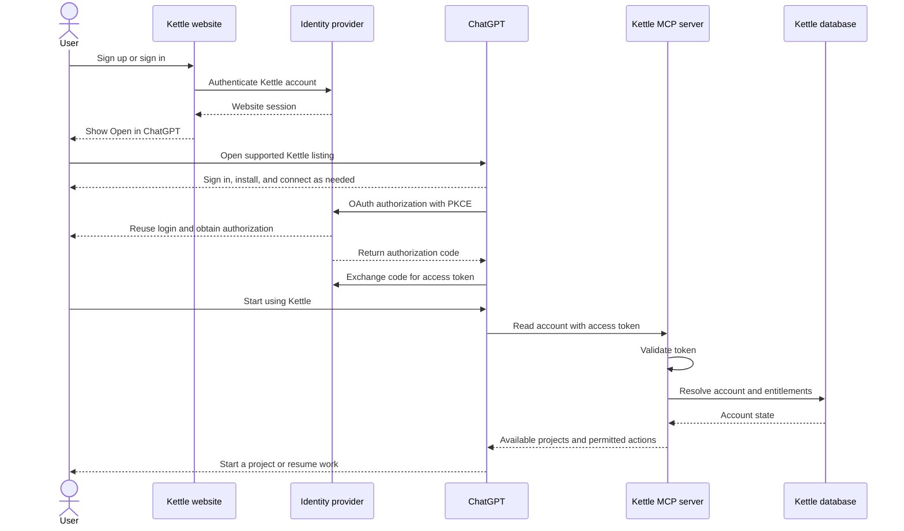
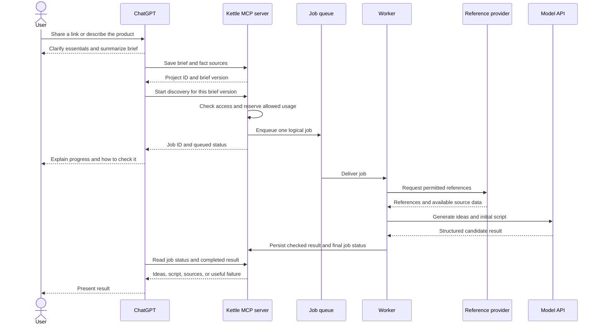
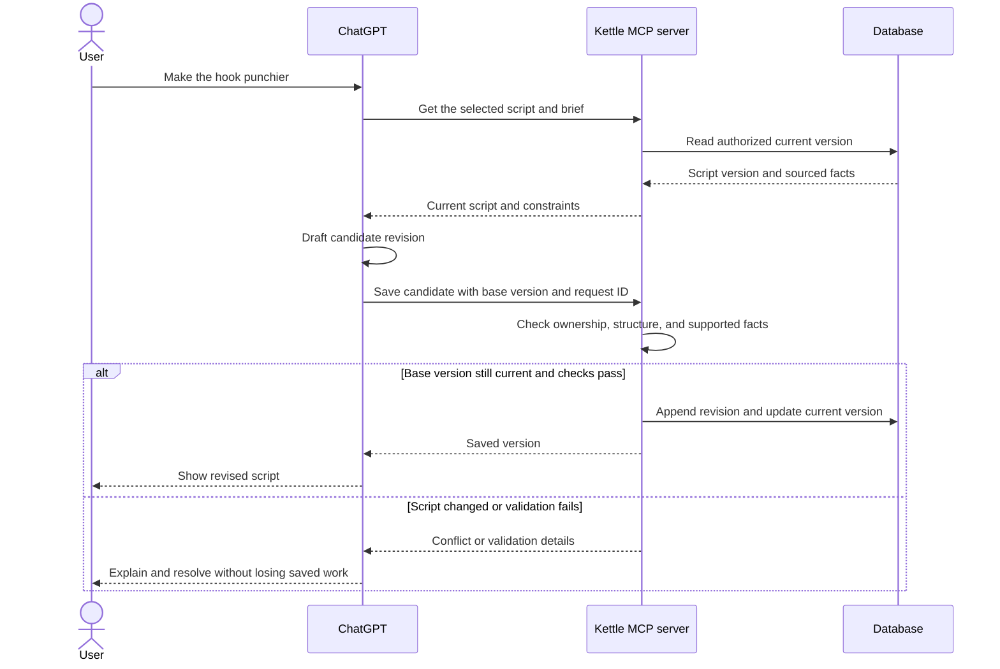
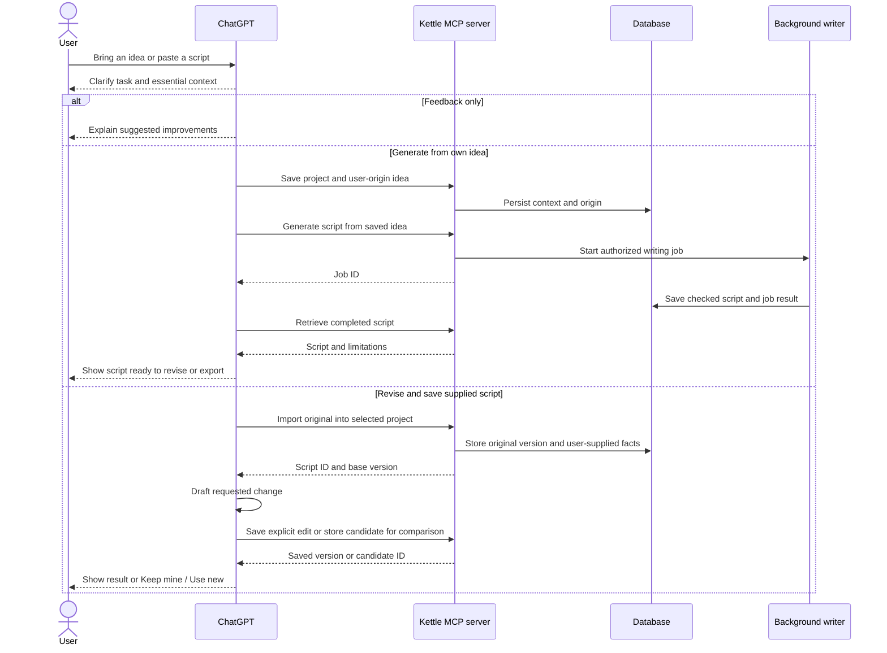

# Kettle User Flows

Revised 6 October 2026 after reviewing the missing journeys against the original product-jobs document. This is a product flow specification, not evidence that these journeys are implemented or that the Paper screens have been verified.

The previous version described the main path from a brief to ideas and a script. The full product also needs entry with an existing idea or script, reference-led work, discovery refinement, version choices, project management, account lifecycle, and recovery. Users should be able to start at the stage that matches what they already have.

Panel tool calls pass through the ChatGPT MCP Apps bridge. They reach the same authorized server operations as chat-initiated calls. The flows are independent of the hosting choice.

Initial runtime mapping: Kettle server = Cloudflare Workers; job runner/worker = Cloudflare Workflows; database = Supabase Postgres. The earlier sequence's "Job queue" denotes recoverable dispatch into Workflows, not an additional deployed queue service. Render is the conditional fallback for runtime flexibility; user-facing flow IDs and tool contracts should remain stable.

The companion [UML sequence collection](09-sequence-diagrams.md) contains a separate diagram for every flow F01-F26. Use the [visual diagram book](diagrams/Kettle%20UML%20Sequence%20Diagrams.pdf) or [offline visual index](diagrams/Kettle%20UML%20Sequence%20Diagrams.html) to inspect the rendered diagrams. Individual editable Mermaid and SVG files are in `diagrams/`.

## Scope and coverage

- **Baseline**: completes the behavior already described in the proposed first release. This is a proposed release scope, not an owner-approved build commitment.
- **Proposed addition**: a newly explicit route or behavior requiring a product decision and tool-contract work.
- **Later**: present in the original product jobs but deferred by the reference pack's narrower launch proposal.
- **Before paid use / before real-user data**: required for that launch condition, even if unnecessary in a fixture-only prototype.

This inventory comes from the supplied jobs text and the user's requests. Newly inferred routes are labelled as proposals. There is no claim of observed user research. Frame references remain unverified until the relevant Paper exports are supplied.

| ID | User goal / entry | Flow endpoint | Scope | Previous coverage |
| --- | --- | --- | --- | --- |
| F01 | Enter through the Kettle website | Correct account connected in ChatGPT | Baseline | Main sequence present |
| F02 | Find Kettle in ChatGPT first | Sign in or create an account, authorize, return to the original task | Baseline | Missing as a separate entry |
| F03 | Start for the first time or return later | Choose new work, an active job, an existing project, or saved work | Baseline | Return only briefly mentioned |
| F04 | Recover login or reconnect the correct account | Authorized session restored without losing saved work | Baseline | Only token expiry in acceptance checks |
| F05 | Supply a description, subject link, profile, or reference | A usable brief with the role of each input understood | Baseline | Mostly covered; input branches thin |
| F06 | Make content as a creator or founder | Brief and output tailored to that project type | Later | Deliberately omitted by launch proposal |
| F07 | Bring an idea and ask for a script | A saved script without mandatory discovery | Proposed addition | Missing |
| F08 | Paste a script to review or revise | Preserved original and a saved, accepted revision | Proposed addition | Missing; only Kettle-created scripts covered |
| F09 | Correct or change an existing brief | New brief version and explicit handling of existing work | Baseline | Correction noted; downstream effects missing |
| F10 | Generate ideas from a brief | Useful ideas, a first script, or an explained no-match outcome | Baseline | Main sequence present |
| F11 | Filter, refine, or request more ideas | Correct local filter, rewrite, or new search | Baseline | Selection context noted; journey missing |
| F12 | Compare ideas and choose one | Chosen idea's script ready; old work preserved | Baseline | Briefly described |
| F13 | Review and revise the filming guide | Accepted change to the intended script/section | Baseline | Basic edit covered; Keep mine / Use new missing |
| F14 | Make a silent, no-face, translated, or alternate version | Related variant with original retained | Later for richer variants; translation is a proposal | Missing |
| F15 | Undo, inspect history, or resolve competing edits | Chosen content becomes current without erasing history | Baseline | Undo mentioned, conflict shown; full journey missing |
| F16 | Export and record filming | Complete script available outside Kettle; explicit filmed status | Baseline | Export missing from flows; filming briefly mentioned |
| F17 | Save, unsave, browse, and resume in Vault | Stable saved item, correct script, and reversible saved status | Baseline | Save/return only a short paragraph |
| F18 | Work across projects; rename, archive, or delete one | Correct project active; content lifecycle clear | Selection/reuse baseline; fuller management later | Mostly missing |
| F19 | Browse Explore and use a hook or other part | Adapted section previewed and accepted into Studio | Later; source permissions required | Deliberately omitted |
| F20 | Leave, resume, retry, or cancel a running task | Accurate final state and consistent usage accounting | Baseline | Leaving and failure partially covered |
| F21 | Start paid access or an adopted trial | Server-confirmed entitlement and return to the task | Before paid use | One paragraph |
| F22 | Reach a limit, encounter payment failure, cancel, or return | Clear access state, saved-work policy, and recovery | Limits baseline; billing branches before paid use | Mostly missing |
| F23 | Disconnect Kettle from ChatGPT | Connection revoked with subscription/data effects explained | Baseline | Revocation only in acceptance checks |
| F24 | Export account data or delete the account | Request completed according to the adopted retention policy | Before real-user data | Only acceptance check |
| F25 | Get help, report a problem, or give feedback | Useful answer or a traceable support/feedback handoff | Basic help before pilot; richer feedback proposed | Missing |
| F26 | Switch chats/devices or work without the panel | Same authorized work with reliable selection and text fallback | Baseline | Partial notes and acceptance checks |

## Route by what the user wants to do

Ask for the minimum context needed for the chosen task. Do not require discovery before editing an existing script, or a new brief before opening saved work. Direct idea and script intake below are proposed additions to make that possible.

| What the user brings | First action | Context needed | Next step |
| --- | --- | --- | --- |
| A product/site/profile link or description | Establish subject, audience, goal, and constraints | A supported source or user-supplied facts; URL optional | Discover ideas (F10) |
| A reference video | Clarify whether it is the subject or a format to adapt | Target product/topic plus the relevant supplied/permitted reference content | Adapt directly if sufficient; otherwise offer discovery (F07/F10) |
| An idea | Preserve their angle and ask what kind of script they need | Enough topic, audience, tone, and format detail to write | Generate script (F07) |
| A script | Preserve the original and ask whether they want feedback or an actual rewrite | Requested change and only the facts needed to make it | Review/revise (F08/F13) |
| Saved work | Find the intended project and piece | Authorized record IDs and current versions | Resume Studio or Vault (F17) |
| An account or billing question | Read relevant account state | Authentication when private data is needed | Help/account route (F04/F21–F25) |

Do not infer that every pasted URL is permission to create a new project or start a paid search. A link shared as inspiration does not establish facts about the user's product. Unsupported access has a description/paste fallback.

## F01 — Website entry and account connection

The website authenticates the Kettle account. The Open in ChatGPT button then opens the supported published listing or entry link. Sign-in to ChatGPT, installation, and Kettle account connection may still be needed. The website login session can simplify OAuth, but it does not itself connect ChatGPT.

The exact production handoff must be tested with the published listing. Use the supported custom-server installation path during private development. Do not invent a URL that promises to open a new conversation with Kettle already selected. See the [OpenAI authentication guide](https://developers.openai.com/plugins/build/auth) and [review requirements](https://developers.openai.com/plugins/deploy/app-review).



For paid access, payment occurs on the Kettle website. A verified Stripe webhook updates entitlements. A checkout return URL alone must not grant access. Final trial and quota behavior is an open product decision.

## F05, F09, F10 — Brief and idea generation

1. The user provides a description or a link. A reference video and a product link have different meanings; clarify their role when ambiguous.
2. ChatGPT extracts available details. A permitted ingestion service may retrieve supported pages. If a link is inaccessible, ask the user for the relevant details and continue.
3. Present the brief in chat and let the user correct material assumptions. Save the usable brief and its fact sources.
4. Start a discovery job. Return a job ID and a real status promptly; the background worker continues independently.
5. Retrieve permitted references, assess relevance, construct ideas, and write the recommended idea's script.
6. Persist a completed result version. Show it in the panel and expose the same useful information to chat through the result tool.
7. If there are insufficient relevant references, return fewer ideas or a no-match result. Explain the outcome and offer a broader brief.



An open panel may poll job status. In chat-only use, explain that the user can ask for status or resume later. Do not promise an unsolicited completion message. Event-driven completion is an optional later integration for compatible ChatGPT surfaces, rather than a requirement of this initial flow.

## F12, F13 — Choosing and revising a script

Choosing the top idea opens its ready script. Choosing an alternative starts script generation if that idea has no script yet. Preserve the current script until the new one succeeds.

For a small chat edit, ChatGPT reads the current script and produces a candidate revision. Kettle checks ownership, structure, and source links and flags unsupported claims before saving; these checks cannot guarantee factual truth. The request includes the version edited so a stale conversation cannot overwrite newer work.

For an explicit instruction such as "replace the hook with this," save the requested revision and allow undo. When the user requests a suggestion or comparison, keep the current script active while showing Keep mine / Use new. Asking "what do you think of this?" should return feedback without silently rewriting saved work. The draft/accept contract needed for comparison is listed in the tools document.



Panel selection context should identify the project, result version, ordered idea IDs, and selected script version. If “the second one” cannot be resolved reliably, ask rather than act on a stale selection.

## F15–F17 — Save and return

Saving the same piece twice creates one Vault item. A return visit authenticates the account, lists saved work, and retrieves the selected script from the database. Marking an item filmed records the user's statement and date. Undo restores content through a new revision or an explicit version selection; it must preserve the revision history.

## Detailed missing journeys

### F02–F04 — Other entry points and account recovery

**ChatGPT first:** discover/select Kettle through a supported entry → attempt the requested task → connect a Kettle account if required → sign in or create it through the authorization flow → grant access → return to the task. A user does not have to manually visit the marketing website first. Public discovery and installation behavior must be tested with the actual supported listing.

**First use:** give a short explanation of what Kettle can do → ask what the user brought → route to a brief, an idea, an existing script, or saved work as supported by the release. Start with their request rather than a forced tour.

**Returning use:** read authorized account state → show relevant projects, saved work, and incomplete/recent jobs → resume the selected item or start new work. An account with no projects gets a useful empty state. A new chat should not force a returning user to repeat a stored brief.

**Recovery:** login fails, consent is declined, a token expires, or the wrong account is connected → explain which connection needs attention → use the identity provider's recovery or supported reconnection route → reread account/project state before continuing. Identify the connected account clearly enough to catch a mismatch. Do not merge accounts or move saved work automatically. Account merging is outside the first-release proposal.

Cancellation of an authorization prompt returns to a usable explanation; it must not create duplicate work or claim access was granted. Website login and MCP authorization remain separate states.

**Owners:** ChatGPT guides the interaction; the website/identity provider handles identity; the MCP server resolves the account and verifies every protected action.

### F05–F06 — Input branches, creator and founder paths

The user may provide one or several inputs. Establish which describes the content subject, which shows a desired style, and whose profile is involved. If two sources conflict, ask about the material fact rather than silently choosing one. Reuse known project details and ask only for missing essentials.

- **Description only:** capture the supplied facts and constraints; no link required.
- **Website/product:** use permitted supported content or ask for pasted details; show the extracted brief for correction.
- **Social profile:** clarify ownership/purpose if ambiguous; if it cannot be read, ask for niche, style, and examples. Do not claim to have inspected it.
- **Reference video:** ask what the user wants to create with that reference. Adaptation can use user-described structure when the original is inaccessible, with that limitation stated.
- **Creator, later:** capture niche, audience, usual style, and desired direction → choose appropriate formats → generate creator content. Connecting a social account is an optional future integration, not a prerequisite.
- **Founder, later:** ask the essential story question → record facts as supplied by the founder → generate a practical format → ask for missing facts or retain visible placeholders → let the founder accept or revise. Do not invent personal history.

Dedicated creator/founder treatment is included in the full product inventory. The pack's brand-first release remains a proposal. The earlier narrowing must not erase these journeys from the product specification.

### F07–F08 — Start with an idea or an existing script

**Proposed addition: existing idea.** User says "I want a video showing how I pack an order" → choose/create the project → preserve their concept → clarify only essential facts, length, and filming constraints → generate a script from that concept → open Studio → revise/export/save. Reference discovery is optional. An idea written by the user must be labelled with that origin and must not acquire invented reference links or performance claims.

**Proposed addition: pasted script.** User pastes text → identify whether they want critique, a specific edit, or a rewrite → show feedback immediately when appropriate → if they want to keep working in Kettle, establish a project and store the original → produce a candidate → apply an explicit edit or offer Keep mine / Use new → preserve versions → export/save. A critique alone must not automatically create saved content. File attachments can be added later; plain pasted text is the first proposed input.

If the script is another creator's reference, route to adaptation with source context rather than treating it as the user's original. Supplied claims can be recorded as user-provided; they must not be presented as independently verified.



The import, user-origin idea, and candidate operations in this diagram are proposed contracts. They are not all covered by the original tool list.

### F09 — Change the brief after work exists

User changes audience, goal, product facts, language, or filming constraints → distinguish a project-wide change from an instruction for one script → show the affected brief fields → save a new brief version when appropriate → offer to revise the current script or generate new ideas.

Existing results remain tied to the brief version that produced them. Clearly indicate when a script uses an older brief. Do not overwrite finished work or launch a paid discovery run merely because a field changed. If an old job finishes later, retain it as work from the old brief and do not replace newer active work.

**Owners:** ChatGPT resolves the intended scope; the server versions facts and briefs; the background worker receives explicit input versions.

### F11–F12 — Filter, refine, compare, and select

Classify the requested change before deciding whether a new search is needed:

| User action | System behavior | Next state |
| --- | --- | --- |
| Click a style chip | Filter already loaded results | Visible subset; clear/reset filter if empty |
| "Show funny demos" when matching cards already exist | Filter/present those cards | Same result version |
| "Find more like the second one" | Resolve the current visible idea, then start a new discovery refinement if needed | New job/result; old result retained |
| "None of these fit" | Ask the most useful correction or propose a wider angle | Revised search only after direction is clear |
| "Keep this idea, change the hook" | Revise the script/concept within the chosen idea | Script edit; no reference search by default |
| Choose top idea | Open its ready script | Studio |
| Choose alternative | Reuse its ready script or generate one | Studio on success; current work retained on failure |
| Open a reference | Open permitted original link and show available attribution | User can return to the same idea |

An empty filter is different from a no-match search. Clear a filter without billing for a new search. Missing thumbnails should show a placeholder and a usable source link when available. Missing or removed sources should be labelled; retain the user's script subject to applicable content rules.

```mermaid
sequenceDiagram
    actor U as User
    participant C as ChatGPT or panel
    participant K as Kettle MCP server
    participant W as Discovery worker
    U->>C: Filter, refine, or change the selected idea
    C->>C: Resolve visible item and intended action
    alt Existing results satisfy the filter
        C-->>U: Show matching saved cards
    else User requests new references
        C->>K: Start discovery refinement with result and idea IDs
        K->>K: Check access, input versions, and usage
        K->>W: Start one logical job
        K-->>C: Job ID; previous results still available
        W->>K: Save new result or useful failure
        C->>K: Read job and result
        K-->>C: New version or recovery action
        C-->>U: Show outcome
    else User requests a script edit
        C->>K: Read selected script and current version
        K-->>C: Script and facts
        C-->>U: Draft requested change through Studio flow
    end
```

### F13–F15 — Studio, variants, and version choices

**Studio:** open complete spoken lines, on-screen text, shots, and estimated timings → identify the intended section → request a change → review the new content → keep the current script or use the new content. When text changes, update dependent shots and timing or explicitly flag them as needing revision. If an edit needs a missing product/story fact, ask for it or keep an explicit placeholder.

**Shorten:** select target length → rewrite while preserving essential facts and intent → recalculate estimated duration → show the result. A duration estimate is not proof that the user can perform the script in that time.

**Variants, later:** request silent/no-face/alternate-hook output → preserve the current script → create a related variant with its own versions → label it clearly → let the user choose which variant to work on or export. A translated-script variant is an additional proposal. Output language, conversation language, and project defaults must not silently overwrite one another.

**Undo/history:** show which revision is current → inspect/select an earlier revision → restore it as a new current revision → retain the full history. For comparison, Keep mine leaves current content unchanged; Use new promotes the candidate only if the current version still matches the candidate's base.

```mermaid
sequenceDiagram
    actor U as User
    participant C as ChatGPT or panel
    participant K as Kettle MCP server
    participant D as Database
    U->>C: Suggest a stronger hook
    C->>K: Get current script
    K-->>C: Script version and facts
    C->>C: Draft candidate hook
    C->>K: Store checked candidate against base version
    K->>D: Retain candidate; keep current pointer unchanged
    K-->>C: Candidate ID
    C-->>U: Show current and proposed hook
    alt Keep mine
        U->>C: Keep mine
        C-->>U: Current script remains active
    else Use new
        U->>C: Use new
        C->>K: Accept candidate with expected current version
        alt Current version matches
            K->>D: Append revision and update current pointer
            K-->>C: Accepted version
        else Another edit was saved
            K-->>C: Version conflict with latest version
            C-->>U: Show changes and resolve the intended edit
        end
    end
```

Stale candidates must not overwrite changes from another chat. Automatic merging of meaningful script edits is not assumed. A low-confidence or unsupported factual claim should lead to a correction request, not a claim that all checks prove the script true.

### F16–F18 — Export, filming, Vault, and projects

**Export:** choose the intended script/variant and current or explicit historical version → return the complete filming guide as plain text → offer panel Copy where supported → provide text fallback if Copy fails. Export does not imply that the user saved the piece to Vault or filmed it. Downloadable documents and public share links are separate future choices.

**Filmed:** user explicitly says the piece is filmed → ensure a stable saved item exists → set filmed status and supplied date, or clearly use the current date if none was supplied → show the saved state → allow correction back to Saved. Kettle does not infer filming from export and does not infer publication or views from filming.

**Vault:** Save for later → upsert one item for the intended piece → show success and Undo save → browse/filter by project or status → choose an item → retrieve the current revision under the proposed latest-version policy → resume Studio. Empty Vault offers a way to start or save work. Unsave removes the Vault bookmark; it does not silently delete the project, script, or version history. This distinction needs an explicit removal tool.

**Projects:** choose between projects → show active project clearly → reuse its saved tone, audience, goal, and constraints → start a new piece or resume one. If a pasted product appears to belong elsewhere, ask whether to update the current project or start another. Do not move data between projects automatically.

**Later management:** rename → update label only; archive → remove from active list while preserving records and offering restore; delete → preview affected records and running jobs → obtain explicit confirmation → apply the adopted deletion policy. Cancel new work and prevent late job completions from recreating a deleted project. A full project home can follow; basic project selection cannot be deferred if multiple projects are stored.

### F19 — Explore and swap a script part, later

Open library from an active script or an independent Explore entry → select hooks/showcases/calls to action → browse/filter or ask for a kind of part in chat → inspect a permitted original and a proposed adaptation → identify the target project/script if none is selected → preview the replacement in context → accept it as a new revision → return to Studio with undo available.

No matching library items → clear filters or broaden the request. A failed adaptation leaves the script unchanged. Never imply that a third-party excerpt is licensed simply because its link is available. Access, storage, display, and adaptation permissions are a dependency for the particular source. Library home and exact attribution presentation remain design decisions.

### F20 — Waiting, partial outcomes, cancellation, and retry

| Event | What the user sees and can do | Server responsibility |
| --- | --- | --- |
| Queued/running | Real progress step; continue elsewhere or return later | Persist job, owner, and input versions |
| Chat or panel closes | Reopen from project/recent jobs and check status | Job continues independently of the open UI |
| Few relevant matches | Use the supported results or broaden the brief | Do not pad the list with invented references |
| No match | Explain the limitation and offer a changed search direction | Record a completed no-match result |
| References found but writing fails | Retain existing work; show any safely persisted usable stage | Resume from a saved stage where supported; do not promise partial results absent from the contract |
| Provider timeout/failure | Clear failure and bounded Try again | Reuse the logical request where appropriate; apply adopted quota policy |
| User requests cancellation | Cancellation requested, then final actual outcome | Prevent queued work starting; stop future stages where possible; account for in-flight cost |
| Cancellation races with completion | Report whether completion or cancellation won | One final state and one usage settlement; no guaranteed refund implied |
| Connection expires mid-job | Reconnect to retrieve status | Use durable account ownership; apply adopted disconnect/revocation policy |
| Newer work finishes first | New work stays current; older work is identifiable | Prevent older completions replacing current selections |

Chat-only users can ask for status or return later. Do not promise a spontaneous completion message on every ChatGPT surface. A retry after changed inputs is new logical work; an accidental duplicate request must not consume usage twice. Exact quota charges, refunds, partial-result availability, and disconnect treatment are open product decisions.

### F21–F23 — Payment, limits, and connection lifecycle

**Website purchase/trial:** choose the adopted offer on the Kettle website → authenticate → complete checkout or trial setup → show pending confirmation if necessary → server receives and verifies the billing event → update entitlement → show account status and Open in ChatGPT → reconnect/reload state and resume. Checkout cancellation or failure leaves the account usable according to its actual access state. A return page alone never proves payment.

**Limit reached:** attempt a metered action → backend checks current entitlement and remaining allowance → explain the actual limit and reset date if known → keep existing permitted work accessible. Define separately whether reading, editing, exporting, discovery, and alternate-script generation consume allowance. Do not invent a reset date or assume every tool is billable. Purchases remain on the website under the current proposal; final in-chat wording and navigation must be checked against current platform rules.

**Subscription lifecycle:** website account page → manage payment method, invoice access, cancellation, or reactivation through the supported billing service → process verified events → show effective access dates and state. Failed payment, cancellation scheduled for period end, expired access, and reactivated access are distinct states. The product must decide which saved-work operations remain available in each; do not silently delete scripts on subscription expiry.

**Disconnect:** user revokes the ChatGPT connection → prevent further protected access according to the implemented revocation policy → explain reconnection. Connection revocation, subscription cancellation, and account deletion are separate requests. Define whether existing jobs stop or complete and how usage is settled. Reconnection resolves the same account's stored records rather than creating a second account automatically.

**Owners:** identity provider and website for identity/account controls; Stripe for billing operations; Kettle backend for verified entitlements, quotas, and data access; ChatGPT for clear status explanations.

### F24–F26 — Data controls, support, and consistent use

**Account data export:** authenticated website request → explain included data → prepare export → deliver securely to the correct account. This differs from exporting one script.

**Account deletion:** authenticated request → explain affected projects, saved work, connected access, active jobs, subscription handling, and any retained records → explicit confirmation → block new work and revoke access → apply deletion and retention policy, including provider-held data where applicable → return truthful completion/status. Backups, accounting records, and external provider retention need a documented policy before real-user data is collected; instant erasure everywhere must not be promised.

**Help and support:** ask how to use Kettle → answer from supported product behavior; report bad results → identify script/job and optional reason → submit only intended diagnostic context; report a billing/account failure → use the agreed support channel → get acknowledgement. Do not send a whole conversation to support by default. Optional ratings and reports need a destination and owner before being presented as a feature.

**Across devices/chats:** authenticate the same account → resolve the selected project and item → load current versions → show panel where supported or equivalent text actions. Filtered order and selected IDs must agree with references such as "the second one." Unsupported or stale context requires a refresh or a short clarification. Avoid making a sidebar extension the only way to resume work; its availability must be verified on supported surfaces.

## Decisions needed before agents build the added routes

1. Adopt direct idea-to-script and pasted-script revision as first-release routes, or explicitly defer them. Recommendation: include them because they serve the user's stated generation/revision jobs without forcing a reference search.
2. Define when a request applies an edit immediately versus creates a candidate. Recommendation: explicit commands apply with undo; requests for suggestions use comparison.
3. Decide how variants, current revisions, and Vault bookmarks relate. Recommendation: preserve originals, version each variant, and reopen the latest revision of the selected variant.
4. Decide quota treatment for discovery, refinement, alternate scripts, retries, partial failures, and cancellations, plus saved-work access after subscription expiry.
5. Adopt retention/deletion, active-job handling, and support policies before a real-user pilot.
6. Confirm whether creator/founder and Explore are later releases. Their flows remain documented even if they are deferred.

The lead agent should turn these decisions into tool contracts and acceptance scenarios. See the additional contract gaps in [Tools and data](04-tools-and-data.md), the added checks in [Acceptance and evaluation](05-acceptance-and-evaluation.md), and the open items in [Decisions and sources](07-decisions-and-sources.md). This inventory does not add automatic publishing, video rendering, team collaboration, or scheduled discovery to the first release.
