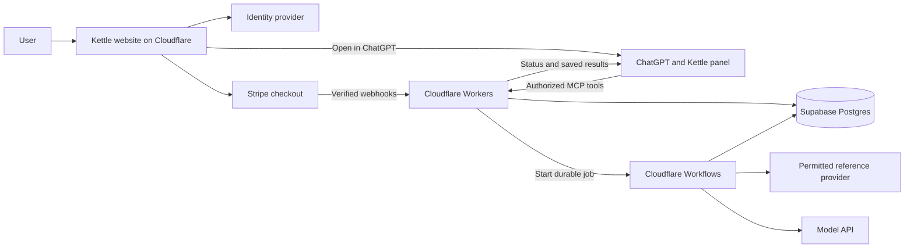

# Kettle Architecture

Hosting decision confirmed by Gustas on 6 October 2026: start with Cloudflare Workers + Workflows and use Supabase Postgres for the database. Render is the fallback if the application requires more runtime flexibility. The selected services still need integration verification; this document does not claim a deployment exists. Other choices remain proposed where labelled.

## System responsibilities

| Component | Responsibility | Implementation direction |
| --- | --- | --- |
| Kettle website | Product information, sign-up, account settings, ChatGPT handoff, billing | Cloudflare Workers + static assets |
| ChatGPT | Conversation, clarification, small script rewrites, tool use | Plugin instructions and MCP tools |
| Kettle panel | Compare ideas, inspect a script, choose, save, and show progress | MCP Apps UI, with text alternatives |
| Kettle server | Token validation, permissions, tools, business rules, usage, and webhooks | Cloudflare Workers |
| Job runner | Provider calls, ranking, background generation, result validation, retries, and job completion | Cloudflare Workflows |
| Database | Accounts, briefs, references, scripts, versions, job state, and usage records | Supabase Postgres |
| Job dispatch | Recoverable creation of workflow instances from saved job requests | Supabase job records + Cloudflare Workflows adapter; no separate queue required by the initial design |
| Identity provider | Website sign-in and OAuth authorization for ChatGPT | Auth0, subject to an integration test |
| Payments | External subscription checkout and billing management | Stripe |
| Reference adapter | Normalize permitted provider data | Lightreel candidate plus a fixture adapter for tests |
| Generation | Kettle-funded background model calls | OpenAI API; choose a model through evaluations |

Use Workers for request handling and Workflows for durable multi-step generation. Keep canonical product data and application job/usage records in Supabase; Cloudflare's workflow execution state is operational state. The earlier Supabase Queues proposal is superseded for the initial implementation. A separate queue can be added if a measured delivery or backpressure requirement justifies it. [Cloudflare MCP hosting](https://developers.cloudflare.com/agents/model-context-protocol/guides/remote-mcp-server/), [Workflow limits and execution](https://developers.cloudflare.com/workflows/reference/limits/).

## Shared application code

Use one application repository. Keep website, panel, MCP server, worker, and shared schemas in separate modules. Share business operations between the website and MCP entry points so permissions and versioning behave consistently. A TypeScript implementation is a reasonable starting proposal, subject to the lead agent's repository assessment.

Keep business logic, prompts, schemas, database access, provider adapters, and usage rules independent of Cloudflare bindings. Put workflow steps, deployment configuration, secrets access, and platform-specific request handling in small adapter modules. These boundaries support a later Render migration without requiring a second deployment implementation now.

Use a documented Supabase connection method: its JavaScript client over HTTPS, or an appropriate direct Postgres driver with Hyperdrive for connection pooling. Choose based on transaction and query needs and verify latency and authorization. Database and business authorization remain the application's responsibility. [Cloudflare's Supabase integration](https://developers.cloudflare.com/workers/databases/third-party-integrations/supabase/).

The development agents build this software. They are separate from the models invoked by Kettle during customer use. A multi-agent production runtime is not part of the current proposal.

## Authentication and ownership

Map the identity provider's stable subject to one internal Kettle account ID. Resolve account identity from validated credentials, never from an account ID supplied by the model. Website sessions and MCP access tokens are separate credentials for the same account.

The MCP server validates token signature, issuer, audience, expiry, and required scopes. It then checks resource ownership and entitlements. A valid token alone does not authorize access to every project. [OpenAI authentication](https://developers.openai.com/plugins/build/auth).

Keep service credentials server-side. Database row-level security can provide another layer, but privileged server connections require their own ownership checks because elevated credentials can bypass those policies.

## Durable work

Create the application job and reserve allowed usage in a Supabase transaction before dispatching provider work. Record pending dispatch in the same transaction. Use a stable job/request identifier to reconcile the Cloudflare workflow instance. If workflow creation fails or its acknowledgement is lost, a bounded dispatcher/reconciliation process must recover the pending request without creating another logical job or quota reservation. Supabase and Cloudflare do not share an atomic transaction.

Workflows runs versioned stages such as reference retrieval, ranking, writing, and result checks. Each stage uses bounded retries and explicit timeouts. Persist user-facing progress and final results in Supabase. Replayed steps must not duplicate final writes or settle quota twice. Record unavoidable repeated provider costs rather than assuming exactly-once external execution.

Expose platform-independent start, status, and cancellation operations through the application layer. The workflow instance ID is an internal execution reference; users and MCP tools use Kettle's job ID. Cancellation records intent, stops future stages where possible, and reports the actual outcome if completion wins the race. Keep generation outside the lifetime of the original HTTP request.

Tie every result to the brief and input versions used. If an older job finishes after a newer one, retain it as history without silently replacing the newer active result.

## Billing and costs

Stripe owns payment processing; Kettle owns product entitlements. Verify and deduplicate webhook events and handle delayed or reordered updates. Define the behavior for payment pending, cancellation, failed payment, refunds, and quota resets before enabling paid use.

Record provider and model usage per job and per account. ChatGPT-authored edits may avoid a separate Kettle model API call, but they still use server resources. Define quota charging separately from the actual costs incurred on failed jobs.

Measure Cloudflare requests, CPU use, workflow steps/state, Supabase use, and external API costs. The choice of Cloudflare is not a verified lowest-cost claim or a fixed monthly budget. [Workers pricing](https://developers.cloudflare.com/workers/platform/pricing/), [Workflows pricing](https://developers.cloudflare.com/workflows/reference/pricing/).

## Render migration path

Use Render if a demonstrated requirement needs runtime behavior that is impractical on the selected Cloudflare services, such as a required native dependency, a full server process, or heavier media processing. Verify current runtime compatibility before deciding to migrate. [Workers Node.js compatibility](https://developers.cloudflare.com/workers/runtime-apis/nodejs/), [Render Docker support](https://render.com/docs/docker).

Move only the affected service where practical. A future Render service/worker should reuse the same application operations, Supabase records, public tool contracts, and provider adapters. Workflows orchestration itself will need an equivalent runner and retry/delivery behavior; that part is not a drop-in migration. Choose its queue or managed workflow mechanism at migration time.

Before a cutover, account for running jobs, route new work to one active runner, preserve deduplication and quota settlement, and verify OAuth, webhook URLs, version compatibility, and rollback. Keep a stable Kettle-owned public domain where the platform permits. These are design boundaries for future work, not a request to provision Render now.

## Reference and data handling

Store normalized reference records with source, observation time, and permitted-use metadata. Treat thumbnails, transcripts, excerpts, metrics, and links as separate fields with potentially different permissions. Public accessibility and creator credit do not by themselves settle permission to reuse a field.

A link-ingestion implementation must use supported and permitted access. Restrict fetch destinations and redirects, limit response sizes, and treat fetched text as untrusted content rather than instructions. Missing access must have a description-based fallback.

Document which customer information reaches each service and how it is retained and deleted. Hosting the database in Europe alone does not describe every data transfer.

## Release verification

First prove an authenticated MCP request on Workers, a Supabase write/read, and a Workflows job that recovers from a failed attempt without duplicate results or usage settlement. Verify installed libraries against the actual runtime. Then test the OAuth connection, panel, reconnection after leaving a running job, cancellation, and cross-account denial before a user pilot. Keep development and production credentials separate. Choose a stable Kettle-owned public endpoint before public submission so hosting can change behind it where the platform contract permits.
