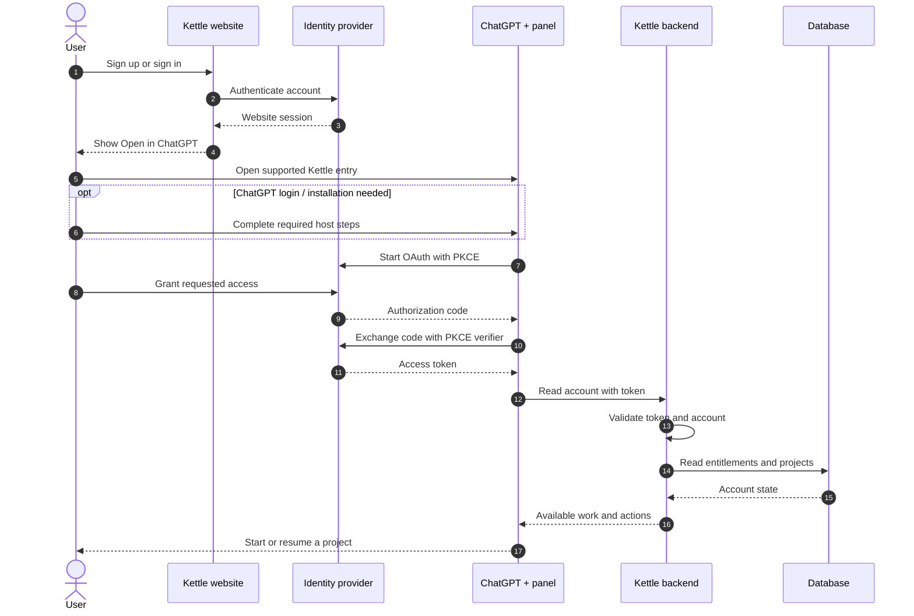
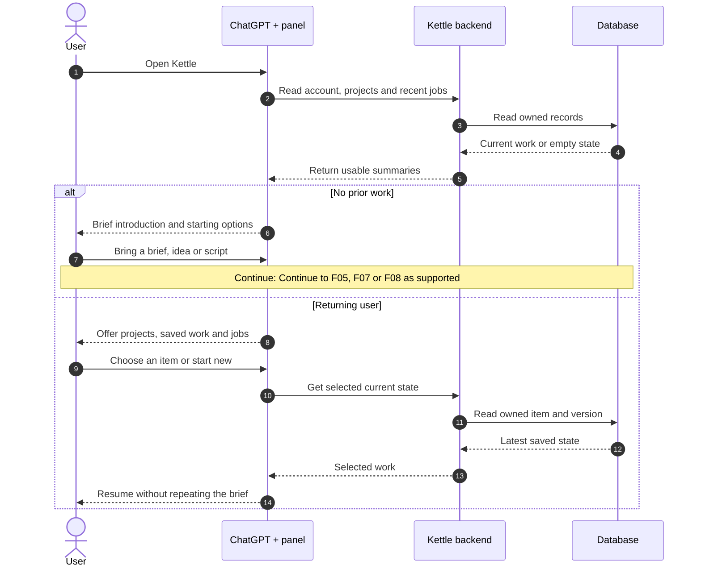
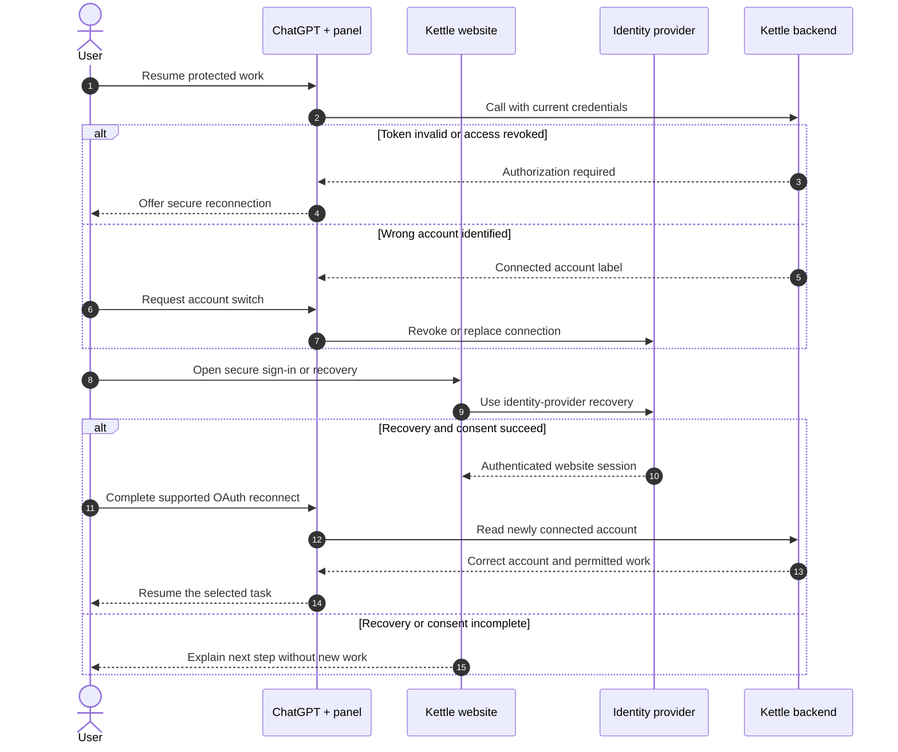
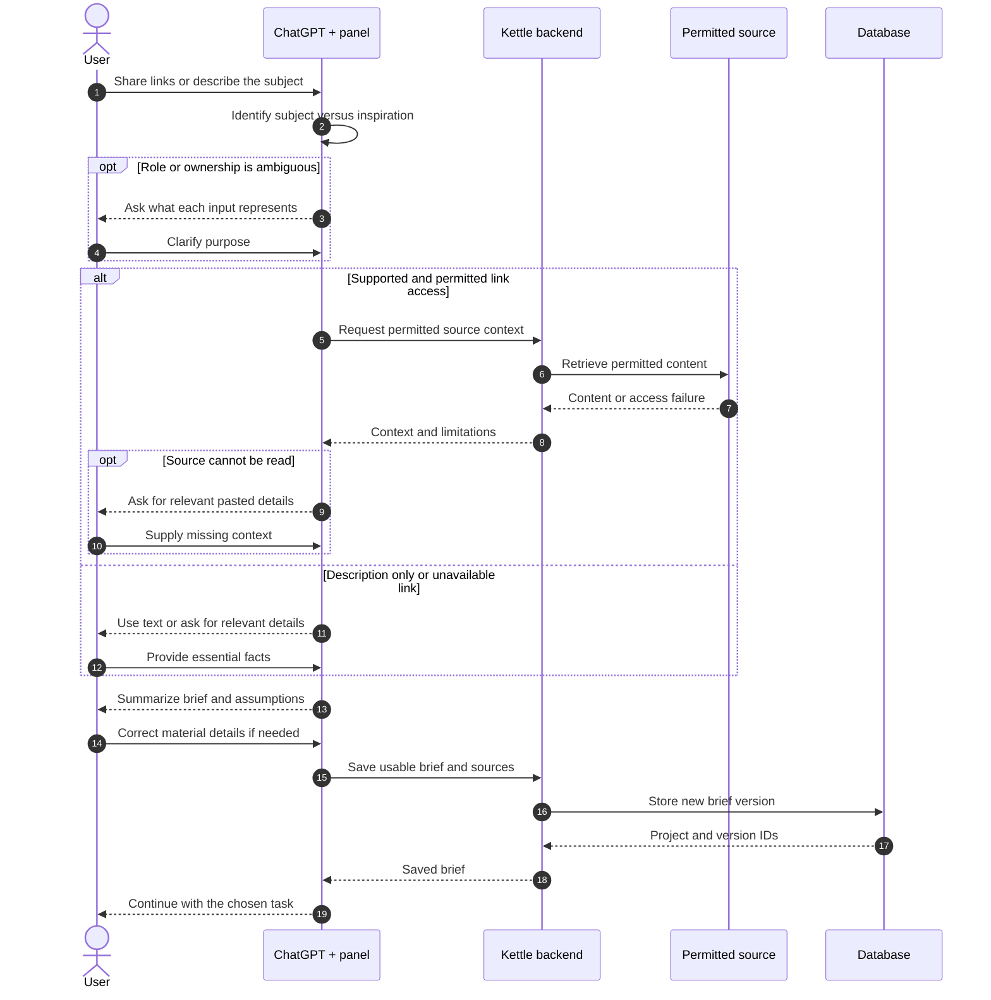

# Kettle UML sequence diagrams

Prepared 6 October 2026. All 26 journeys from [User flows](02-user-flows.md). These are proposed behavior diagrams, not evidence of implemented or approved features.

## Reading the diagrams

- Read time from top to bottom. Columns are people or systems; vertical dashed lines are their lifelines.
- Solid arrows show requests/actions. Dashed arrows show responses. Numbered messages make the sequence easy to discuss.
- `alt` encloses alternative branches; `opt` encloses an optional path. Notes refer to another flow or explain a condition.
- **ChatGPT + panel** groups the conversation, optional Kettle UI, and host bridge. Panel calls use the supported bridge; the panel does not bypass server authorization.
- **Kettle backend** includes MCP tools and internal application services. The job runner uses durable server-side work; diagrams do not select a hosting provider.
- Protected calls validate credentials, ownership, and action entitlement. Writes/jobs use request IDs; updates also check their base version. These repeat checks are not drawn on every arrow.
- Background jobs return an ID promptly. Status is read through an open panel or a user request; no general promise of unsolicited chat completion messages.
- Identity provider, reference source, and job runner are roles. Auth0 and Lightreel remain candidates. Hosting is now Cloudflare Workers + Workflows with Supabase Postgres; Render is the conditional fallback. Stripe is the intended billing provider. The vendor-neutral sequence drawings remain applicable.

## Contents

| Flow | Journey | Scope |
| --- | --- | --- |
| F01 | [Enter from the Kettle website](#f01---enter-from-the-kettle-website) | Baseline |
| F02 | [Enter from ChatGPT](#f02---enter-from-chatgpt) | Baseline |
| F03 | [First use or a return visit](#f03---first-use-or-a-return-visit) | Baseline |
| F04 | [Recover access or switch account](#f04---recover-access-or-switch-account) | Baseline |
| F05 | [Build a brief from links or text](#f05---build-a-brief-from-links-or-text) | Baseline |
| F06 | [Creator or founder content](#f06---creator-or-founder-content) | Later |
| F07 | [Turn your own idea into a script](#f07---turn-your-own-idea-into-a-script) | Proposed addition |
| F08 | [Review or revise a pasted script](#f08---review-or-revise-a-pasted-script) | Proposed addition |
| F09 | [Change the brief after work exists](#f09---change-the-brief-after-work-exists) | Baseline |
| F10 | [Discover video ideas and a first script](#f10---discover-video-ideas-and-a-first-script) | Baseline |
| F11 | [Filter, refine, or ask for more ideas](#f11---filter-refine-or-ask-for-more-ideas) | Baseline |
| F12 | [Compare ideas and choose one](#f12---compare-ideas-and-choose-one) | Baseline |
| F13 | [Revise and accept a script change](#f13---revise-and-accept-a-script-change) | Baseline |
| F14 | [Create a related script variant](#f14---create-a-related-script-variant) | Later / proposed translation |
| F15 | [Undo, restore history, or resolve conflict](#f15---undo-restore-history-or-resolve-conflict) | Baseline |
| F16 | [Export a script and record filming](#f16---export-a-script-and-record-filming) | Baseline |
| F17 | [Save, unsave, browse, and resume](#f17---save-unsave-browse-and-resume) | Baseline |
| F18 | [Select and manage projects](#f18---select-and-manage-projects) | Baseline selection / later management |
| F19 | [Explore and replace a script section](#f19---explore-and-replace-a-script-section) | Later / source permissions required |
| F20 | [Leave, resume, retry, or cancel a job](#f20---leave-resume-retry-or-cancel-a-job) | Baseline |
| F21 | [Start paid access or an adopted trial](#f21---start-paid-access-or-an-adopted-trial) | Before paid use |
| F22 | [Limits, failed payment, and cancellation](#f22---limits-failed-payment-and-cancellation) | Limits baseline / billing before paid use |
| F23 | [Disconnect and reconnect ChatGPT](#f23---disconnect-and-reconnect-chatgpt) | Baseline |
| F24 | [Export account data or delete account](#f24---export-account-data-or-delete-account) | Before real-user data |
| F25 | [Get help, report issues, give feedback](#f25---get-help-report-issues-give-feedback) | Basic help before pilot / feedback proposed |
| F26 | [Switch chat or device; use text fallback](#f26---switch-chat-or-device-use-text-fallback) | Baseline |

The PDF and SVG drawings are generated from the same steps as the Mermaid source below. Follow the linked flow specification for full policy context.

## F01 - Enter from the Kettle website

**Scope:** Baseline  
**Entry:** User starts on the Kettle website.  
**Outcome:** The intended Kettle account is connected and ready.



**Rule / decision:** Website login does not itself connect ChatGPT. Verify the actual published handoff; do not assume a preselected-chat URL.

## F02 - Enter from ChatGPT

**Scope:** Baseline  
**Entry:** User finds Kettle inside ChatGPT and asks for help.  
**Outcome:** Authorization completes and the original task can continue.

```mermaid
sequenceDiagram
    autonumber
    actor U as User
    participant C as ChatGPT + panel
    participant A as Identity provider
    participant K as Kettle backend
    participant D as Database
    U->>C: Select Kettle and request a task
    C->>K: Attempt protected operation
    K-->>C: Connection required; no write
    C->>A: Open supported authorization
    U->>A: Sign in or create account
    alt User grants access
        A-->>C: Authorization code
        C->>A: Exchange code using PKCE
        A-->>C: Access token
        C->>K: Read account with token
        K->>D: Resolve authorized account
        D-->>K: Account and entitlements
        K-->>C: Permitted actions
        C-->>U: Resume original request
    else User declines or leaves
        A-->>C: Authorization not completed
        C-->>U: Explain how to connect later
    end
```

**Rule / decision:** No duplicate job is created during connection. Sign-up can occur in the authorization flow; a separate marketing-site visit is unnecessary.

## F03 - First use or a return visit

**Scope:** Baseline  
**Entry:** User opens Kettle with an authorized account.  
**Outcome:** The user reaches the appropriate new or existing work.



**Rule / decision:** Direct idea and pasted-script options depend on adoption of F07/F08. Finding jobs must work without the original conversation or job ID.

## F04 - Recover access or switch account

**Scope:** Baseline  
**Entry:** Login fails, authorization expires, or the wrong account is connected.  
**Outcome:** The correct account is verified before protected work resumes.



**Rule / decision:** Reconnect includes the authorization-code/PKCE exchange in F01. Never merge accounts or transfer content automatically.

## F05 - Build a brief from links or text

**Scope:** Baseline  
**Entry:** User shares a description, website, product, profile, or reference.  
**Outcome:** A usable, corrected brief is stored with its fact sources.



**Rule / decision:** URL access is an optional, permission-dependent adapter. If access fails, continue with user-supplied details. Saving a brief does not start a paid search.

## F06 - Creator or founder content

**Scope:** Later  
**Entry:** User wants a creator-style video or a founder story.  
**Outcome:** The chosen project type shapes the script without invented personal facts.

```mermaid
sequenceDiagram
    autonumber
    actor U as User
    participant C as ChatGPT + panel
    participant K as Kettle backend
    participant D as Database
    participant J as Job runner
    U->>C: Describe creator or founder goal
    alt Creator project
        C-->>U: Ask niche, audience and usual style
        U->>C: Describe style or provide examples
    else Founder project
        C-->>U: Ask the essential story question
        U->>C: Supply personal facts and constraints
    end
    C->>K: Save type, brief and fact origins
    K->>D: Persist sourced brief version
    K-->>C: Project ready
    U->>C: Request ideas or a script
    C->>K: Start authorized generation
    K->>J: Run with type and constraints
    K-->>C: Job ID
    J->>D: Save checked result or placeholders
    C->>K: Read completed result
    K-->>C: Relevant ideas and script
    C-->>U: Review; fill missing personal facts
```

**Rule / decision:** Use F10 for discovery or F07 for direct writing. Social-account connection is optional; unsupported profiles use a description fallback.

## F07 - Turn your own idea into a script

**Scope:** Proposed addition  
**Entry:** User already knows what they want to film.  
**Outcome:** A user-origin idea becomes a saved script without mandatory discovery.

```mermaid
sequenceDiagram
    autonumber
    actor U as User
    participant C as ChatGPT + panel
    participant K as Kettle backend
    participant D as Database
    participant J as Job runner
    participant M as Model API
    U->>C: Share an idea and request a script
    C-->>U: Clarify only essential context
    U->>C: Provide facts and filming constraints
    C->>K: Save project and user-origin idea
    K->>D: Persist idea and brief version
    K-->>C: Idea ID
    C->>K: Generate script for the idea
    K->>K: Check access and reserve usage
    K->>J: Enqueue one writing job
    K-->>C: Job ID
    J->>M: Draft with brief and constraints
    M-->>J: Structured script candidate
    alt Output checks pass
        J->>D: Save script and settle job
        C->>K: Retrieve completed script
        K-->>C: Script and source limitations
        C-->>U: Open Studio or export
    else Writing or checks fail
        J->>D: Record recoverable failure
        C->>K: Read job outcome
        K-->>C: Failure; previous work preserved
        C-->>U: Correct input or retry
    end
```

**Rule / decision:** No reference provider is required. Never invent reference links, performance claims, or independent verification of user-supplied facts.

## F08 - Review or revise a pasted script

**Scope:** Proposed addition  
**Entry:** User pastes an existing script.  
**Outcome:** Feedback stays conversational; saved editing preserves the original.

```mermaid
sequenceDiagram
    autonumber
    actor U as User
    participant C as ChatGPT + panel
    participant K as Kettle backend
    participant D as Database
    U->>C: Paste script and state the task
    C->>C: Distinguish own draft from reference
    alt Feedback only
        C-->>U: Explain suggested improvements
        Note over U,D: No import or saved rewrite is required.
    else User requests editing in Kettle
        C-->>U: Confirm target project and essentials
        U->>C: Supply missing context
        C->>K: Import original script
        K->>D: Store original and fact origins
        K-->>C: Script ID and base version
        C->>C: Draft requested revision
        alt Explicit instruction to apply edit
            C->>K: Save revision against base version
            K->>D: Append checked revision
            K-->>C: New current version
            C-->>U: Show saved edit with undo
        else Suggestion or comparison requested
            C->>K: Store candidate without applying
            K->>D: Preserve current; store candidate
            C-->>U: Keep mine or Use new
            Note over U,D: Continue: Acceptance and conflict handling: F13/F15
        end
    end
```

**Rule / decision:** Plain pasted text is the proposed first input. A third-party script is adaptation material, not the user's original. All saves use ownership and version checks.

## F09 - Change the brief after work exists

**Scope:** Baseline  
**Entry:** User changes audience, facts, goal, tone, language, or filming constraints.  
**Outcome:** The intended scope changes while existing outputs retain their history.

```mermaid
sequenceDiagram
    autonumber
    actor U as User
    participant C as ChatGPT + panel
    participant K as Kettle backend
    participant D as Database
    participant J as Job runner
    U->>C: Request a context change
    C-->>U: Resolve one-script versus project scope
    alt Change applies to one script
        Note over U,J: Continue: Revise the selected script through F13
    else Change applies to the project
        C->>K: Read current brief and version
        K-->>C: Current fields and linked work
        C->>K: Save changed fields and sources
        K->>D: Append brief version
        K-->>C: New version; prior work retained
        C-->>U: Offer revision or new discovery
        opt User requests new generation
            C->>K: Start job with new brief version
            K->>J: Enqueue authorized work
            K-->>C: Job ID
        end
        opt Older job completes later
            J->>D: Save result under its original brief
            Note over U,J: Older completion cannot replace newer active work.
        end
    end
```

**Rule / decision:** A field change alone does not launch a paid search. Show when a script was generated from an older brief.

## F10 - Discover video ideas and a first script

**Scope:** Baseline  
**Entry:** User requests ideas for a saved brief.  
**Outcome:** Relevant ideas and a script are saved, or a useful no-match/failure is recorded.

```mermaid
sequenceDiagram
    autonumber
    actor U as User
    participant C as ChatGPT + panel
    participant K as Kettle backend
    participant J as Job runner
    participant R as Reference source
    participant M as Model API
    participant D as Database
    U->>C: Find my next video
    C->>K: Start discovery with brief version
    K->>K: Check access; deduplicate; reserve usage
    K->>J: Enqueue durable discovery job
    K-->>C: Job ID and queued state
    C-->>U: Show progress and return path
    J->>R: Search permitted references
    R-->>J: References and available source data
    alt Enough relevant source material
        J->>M: Rank ideas and draft top script
        M-->>J: Structured ideas and script
        J->>J: Check structure and factual support
        J->>D: Save result version and job outcome
    else Few or no relevant matches
        J->>D: Save fewer results or no-match
    else Provider or writing failure
        J->>D: Save recoverable failure; retain old work
    end
    C->>K: Read status when panel polls or user asks
    K->>D: Read authorized job and result
    D-->>K: Actual saved outcome
    K-->>C: Ideas, script or useful limitation
    C-->>U: Show outcome and next action
```

**Rule / decision:** Lightreel is an optional reference adapter subject to permissions. No padded references, invented metrics, or guaranteed unsolicited completion message.

## F11 - Filter, refine, or ask for more ideas

**Scope:** Baseline  
**Entry:** User changes the visible ideas or asks for a different direction.  
**Outcome:** The request triggers filtering, a script edit, or a new search as appropriate.

```mermaid
sequenceDiagram
    autonumber
    actor U as User
    participant C as ChatGPT + panel
    participant K as Kettle backend
    participant J as Job runner
    participant D as Database
    U->>C: Filter, refine, or change direction
    C->>C: Resolve intent and visible idea IDs
    opt Selection is stale or ambiguous
        C->>K: Refresh saved result and order
        K-->>C: Current result IDs
        C-->>U: Clarify the intended item if needed
    end
    alt Existing cards satisfy the request
        C->>C: Filter the loaded result
        C-->>U: Show matches or clear-filter option
    else User requests new references
        C->>K: Start refinement with brief and result IDs
        K->>K: Check entitlement and deduplicate
        K->>J: Enqueue new search
        K-->>C: Job ID; prior cards remain
        J->>D: Save next result or failure
        C->>K: Read completed outcome
        K-->>C: New result version or recovery
        C-->>U: Present new choices
    else Same idea; change only the script
        Note over U,D: Continue: Continue through F13 without reference search
    end
```

**Rule / decision:** An empty filter is not a failed search. A genuine new search may consume allowance; local filtering does not incur another provider search.

## F12 - Compare ideas and choose one

**Scope:** Baseline  
**Entry:** User is comparing a saved set of ideas.  
**Outcome:** The chosen idea opens in Studio without discarding the current script on failure.

```mermaid
sequenceDiagram
    autonumber
    actor U as User
    participant C as ChatGPT + panel
    participant K as Kettle backend
    participant D as Database
    participant J as Job runner
    U->>C: Compare ideas and inspect sources
    C->>K: Get saved result and ordered idea IDs
    K->>D: Read owned result
    K-->>C: Ideas, rationale and permitted source links
    C-->>U: Show choices; label missing previews
    opt User opens an original
        U->>C: Open source link
        C-->>U: Use supported external link opener
    end
    U->>C: Use this idea
    C->>K: Get or generate selected script
    alt Matching script is already ready
        K->>D: Read ready script
        K-->>C: Script and current version
        C-->>U: Open Studio
    else Script needs generation
        K->>J: Start authorized writing job
        K-->>C: Job ID; current script preserved
        J->>D: Save new script or failure
        C->>K: Read job outcome
        K-->>C: Ready script or failure details
        C-->>U: Open ready script or keep current
    end
```

**Rule / decision:** Choosing the top idea normally reuses its initial script. Duplicate clicks reuse the logical request rather than charging twice.

## F13 - Revise and accept a script change

**Scope:** Baseline  
**Entry:** User requests an edit or asks for a suggested improvement.  
**Outcome:** An intended edit is saved, or the current script survives rejection/conflict.

```mermaid
sequenceDiagram
    autonumber
    actor U as User
    participant C as ChatGPT + panel
    participant K as Kettle backend
    participant D as Database
    U->>C: Request edit or suggested improvement
    C->>K: Get selected script and brief facts
    K->>D: Read owned current version
    K-->>C: Script, facts and base version
    C->>C: Draft lines, shots and timing changes
    alt Explicit command to apply change
        C->>K: Save revision with expected version
        Note over U,D: Continue: Apply common version and content checks below
    else Suggestion or comparison
        C->>K: Store checked candidate only
        K->>D: Preserve current; save candidate
        C-->>U: Show Keep mine / Use new
        alt Keep mine
            C-->>U: Current script stays active
        else Use new
            U->>C: Accept candidate
            C->>K: Accept against expected current version
        end
    end
    opt A save or acceptance was requested
        alt Version matches and checks pass
            K->>D: Append revision; update current pointer
            K-->>C: Saved version and estimated timing
            C-->>U: Show revision with undo
        else Version conflict or unsupported claim
            K-->>C: Conflict or validation details
            C-->>U: Refresh, clarify facts, or revise candidate
        end
    end
```

**Rule / decision:** Ownership, structure and source checks apply to every saved edit. Checks flag problems; they do not prove all claims true. Keep shots and timing consistent.

## F14 - Create a related script variant

**Scope:** Later / proposed translation  
**Entry:** User asks for silent, no-face, alternate-hook, or translated output.  
**Outcome:** A separate variant preserves the source script and has its own revisions.

```mermaid
sequenceDiagram
    autonumber
    actor U as User
    participant C as ChatGPT + panel
    participant K as Kettle backend
    participant D as Database
    U->>C: Request a new format or language
    C->>K: Get selected script and facts
    K->>D: Read script and source version
    K-->>C: Original and constraints
    C-->>U: Clarify variant and essential limits
    U->>C: Specify target format
    C->>C: Adapt lines, text, shots and timing
    C->>K: Create variant linked to source version
    alt Checks pass
        K->>D: Store variant with its own current version
        K-->>C: Variant ID; original preserved
        C-->>U: Review variant or return to original
        U->>C: Choose variant to revise or export
        Note over U,D: Continue: Continue through F13 or F16
    else Facts or structure need correction
        K-->>C: Validation details; original unchanged
        C-->>U: Ask for correction or retain original
    end
```

**Rule / decision:** Variant language must not silently change conversation or project language. Direct ChatGPT drafting is shown; background writing can use the F07 job pattern.

## F15 - Undo, restore history, or resolve conflict

**Scope:** Baseline  
**Entry:** User requests undo, chooses an earlier version, or encounters a stale edit.  
**Outcome:** A deliberate current version is saved while all previous revisions remain.

```mermaid
sequenceDiagram
    autonumber
    actor U as User
    participant C as ChatGPT + panel
    participant K as Kettle backend
    participant D as Database
    U->>C: Undo or inspect revision history
    C->>K: List versions for selected script
    K->>D: Read owned history
    K-->>C: Version summaries and current ID
    C-->>U: Show previous and current versions
    U->>C: Choose version to restore
    C->>K: Restore with expected current version
    alt Expected version is still current
        K->>D: Append restored content as new revision
        K-->>C: New current version; history intact
        C-->>U: Show restored script
    else Another chat saved newer content
        K-->>C: Conflict; newest version preserved
        C->>K: Read newest content and chosen version
        K-->>C: Both versions
        C-->>U: Explain difference and intended change
        U->>C: Choose how to proceed
        C->>K: Resubmit against refreshed version
        Note over U,D: Continue: Recheck version before applying any change
    end
```

**Rule / decision:** Restore is not destructive rollback. The same conflict-resolution branch applies to stale edits and candidate acceptance.

## F16 - Export a script and record filming

**Scope:** Baseline  
**Entry:** User wants the script outside Kettle or reports filming it.  
**Outcome:** The complete intended version is exported; filmed status changes only explicitly.

```mermaid
sequenceDiagram
    autonumber
    actor U as User
    participant C as ChatGPT + panel
    participant K as Kettle backend
    participant D as Database
    U->>C: Export selected script
    C->>K: Read chosen script, variant and version
    K->>D: Read authorized content
    K-->>C: Complete filming guide
    C-->>U: Return full readable text
    opt Panel Copy is supported
        U->>C: Copy the full script
        C-->>U: Copy result or text fallback
    end
    Note over U,D: Export does not mark the piece filmed.
    opt User explicitly reports filming
        U->>C: I filmed it; optional date
        C->>K: Ensure saved item; set filmed status
        K->>D: Upsert item and record date
        K-->>C: Saved filmed state
        C-->>U: Confirm date and allow correction
        opt User corrects the status
            U->>C: Mark it saved, not filmed
            C->>K: Update status with expected version
            K->>D: Persist corrected state
            C-->>U: Show corrected status
        end
    end
```

**Rule / decision:** Use supplied filmed date or clearly state today when omitted. Filmed is self-reported; it does not prove publication or performance.

## F17 - Save, unsave, browse, and resume

**Scope:** Baseline  
**Entry:** User saves a piece or opens Vault from a later conversation.  
**Outcome:** One saved association points to work that can be reliably resumed.

```mermaid
sequenceDiagram
    autonumber
    actor U as User
    participant C as ChatGPT + panel
    participant K as Kettle backend
    participant D as Database
    alt Save for later
        U->>C: Save this piece
        C->>K: Save Vault item with request ID
        K->>D: Upsert one saved association
        K-->>C: Stable Vault item ID
        C-->>U: Saved; offer Undo save
        opt Undo save
            U->>C: Unsave
            C->>K: Remove saved association
            K->>D: Preserve script and history
            C-->>U: Piece removed from saved list
        end
    else Browse or resume
        U->>C: Show my saved work
        C->>K: List by project or status
        K->>D: Read owned Vault items
        K-->>C: Items or empty state
        C-->>U: Show list or useful start action
        opt User chooses a saved item
            U->>C: Open selected piece
            C->>K: Get item and current script
            K->>D: Read latest selected variant revision
            K-->>C: Saved script and project context
            C-->>U: Resume Studio
        end
    end
```

**Rule / decision:** Proposed policy: reopen the current revision of the selected variant. Unsave is not project or script deletion. Repeated saves must not duplicate the item.

## F18 - Select and manage projects

**Scope:** Baseline selection / later management  
**Entry:** User works across products or manages an existing project.  
**Outcome:** The selected project is clear; lifecycle actions preserve or remove data deliberately.

```mermaid
sequenceDiagram
    autonumber
    actor U as User
    participant C as ChatGPT + panel
    participant K as Kettle backend
    participant D as Database
    participant J as Job runner
    U->>C: Choose a project
    C->>K: List owned projects
    K-->>C: Project summaries
    U->>C: Select project or create a new one
    C->>K: Load or create the intended project
    K->>D: Read or save project context
    K-->>C: Active brief and work IDs
    C-->>U: Show active project
    opt Later project management
        U->>C: Request rename, archive, restore or delete
        alt Rename, archive or restore
            C->>K: Apply explicit lifecycle update
            K->>D: Update label or reversible state
            C-->>U: Show new project state
        else Delete project
            C->>K: Preview deletion impact
            K-->>C: Affected records and running jobs
            C-->>U: Explain impact and request confirmation
            U->>C: Explicitly confirm deletion
            C->>K: Submit confirmed deletion
            K->>D: Mark deleting; block new writes
            K->>J: Stop future work under adopted policy
            K->>D: Delete or retain per policy
            C-->>U: Show truthful deletion status
        end
    end
```

**Rule / decision:** A late job cannot recreate a deleted project. Do not move content between projects automatically. Archive remains reversible; delete follows the adopted policy.

## F19 - Explore and replace a script section

**Scope:** Later / source permissions required  
**Entry:** User browses hooks or other parts from Studio or Explore.  
**Outcome:** A permitted part is adapted, previewed, and accepted as a revision.

```mermaid
sequenceDiagram
    autonumber
    actor U as User
    participant C as ChatGPT + panel
    participant K as Kettle backend
    participant D as Database
    participant M as Model API
    U->>C: Browse hooks, showcases or calls to action
    C->>K: Search permitted library for project
    K->>D: Read eligible library records
    K-->>C: Matching parts or empty state
    C-->>U: Show choices or broaden-filter action
    opt User chooses a part
        U->>C: Choose part and target script
        C->>K: Adapt selected part to current script
        K->>D: Read permitted source and base version
        K->>M: Draft project-specific replacement
        alt Adaptation succeeds and checks pass
            M-->>K: Replacement candidate
            K->>D: Store candidate; keep script current
            K-->>C: Permitted original and your version
            C-->>U: Preview replacement in context
            opt User accepts
                U->>C: Use this part
                C->>K: Accept with expected base version
                K->>D: Append revision if version still matches
                K-->>C: Saved revision or version conflict
                C-->>U: Return to Studio or resolve conflict
            end
        else Adaptation fails
            K-->>C: Useful failure; current script unchanged
            C-->>U: Try another part or keep script
        end
    end
```

**Rule / decision:** Source access, storage, display and adaptation permissions must be established first. Slow adaptation uses the durable job pattern; no literal promise of an immediate response.

## F20 - Leave, resume, retry, or cancel a job

**Scope:** Baseline  
**Entry:** A generation job exists and the user leaves or changes course.  
**Outcome:** A retrievable final outcome is recorded with one quota settlement.

```mermaid
sequenceDiagram
    autonumber
    actor U as User
    participant C as ChatGPT + panel
    participant K as Kettle backend
    participant D as Database
    participant J as Job runner
    U->>C: Leave while work is running
    J->>D: Persist real steps independently
    U->>C: Return and ask for progress
    C->>K: Find or read owned job
    K->>D: Read actual state and partial result IDs
    K-->>C: Queued, running or final outcome
    alt Ready, fewer matches, or no match
        C-->>U: Show usable result and limitations
    else Failed and user requests retry
        U->>C: Try again
        C->>K: Retry with logical request context
        K->>K: Check access and adopted quota policy
        K->>J: Resume saved stage or bounded retry
        K-->>C: Actual job state
    else User requests cancellation
        U->>C: Cancel this job
        C->>K: Record cancellation request
        K->>D: Mark cancellation requested
        K->>J: Stop future stages where possible
        K-->>C: Cancellation requested; not guaranteed
        J->>D: Finalize completed or cancelled outcome
        K->>D: Settle reserved usage once
        C->>K: Read final outcome
        K-->>C: Actual completion/cancellation state
        C-->>U: Explain outcome and usage
    end
```

**Rule / decision:** Completion may win a cancellation race. In-flight provider cost can remain. Partial output is shown only if persisted and supported. No unsolicited chat notification assumed.

## F21 - Start paid access or an adopted trial

**Scope:** Before paid use  
**Entry:** User chooses an offer on the authenticated Kettle website.  
**Outcome:** Access follows verified account state and the user can return to ChatGPT.

```mermaid
sequenceDiagram
    autonumber
    actor U as User
    participant W as Kettle website
    participant S as Stripe
    participant K as Kettle backend
    participant D as Database
    participant C as ChatGPT + panel
    U->>W: Choose adopted plan or trial
    W->>K: Request account-bound billing action
    alt Checkout is required
        K->>S: Create account-bound checkout
        S-->>K: Checkout session
        K-->>W: Hosted checkout destination
        U->>S: Complete payment or billing setup
        alt Successful checkout
            S-->>W: Browser return; confirmation may be pending
            S->>K: Send signed billing webhook
            K->>K: Verify and deduplicate billing event
            K->>D: Update entitlement from verified state
        else Checkout cancelled or failed
            S-->>W: Return without confirmed access
        end
    else Trial requires no checkout
        K->>K: Check adopted trial eligibility
        K->>D: Create eligible trial entitlement once
    end
    W->>K: Read current account access
    K-->>W: Active, pending or unavailable
    W-->>U: Show state and Open in ChatGPT
    U->>C: Open Kettle and connect if needed
    C->>K: Refresh authorized account state
    K-->>C: Permitted actions
    C-->>U: Resume when access is available
```

**Rule / decision:** The browser return and webhook may arrive in either order. A return URL never grants access. Trial, price and allowance are unresolved product choices.

## F22 - Limits, failed payment, and cancellation

**Scope:** Limits baseline / billing before paid use  
**Entry:** User reaches a quota, encounters renewal failure, cancels, or reactivates.  
**Outcome:** Access and saved-work behavior follow an explicit entitlement policy.

```mermaid
sequenceDiagram
    autonumber
    actor U as User
    participant C as ChatGPT + panel
    participant W as Kettle website
    participant S as Stripe
    participant K as Kettle backend
    participant D as Database
    alt A requested action exceeds access or quota
        U->>C: Request metered action
        C->>K: Attempt authorized operation
        K->>D: Read entitlement and allowance
        K-->>C: Limit or unavailable action; known reset
        C-->>U: Explain status and allowed saved-work actions
    else Payment failure or subscription change
        opt User initiates management
            U->>W: Manage payment, cancel or reactivate
            W->>K: Request authenticated billing portal
            K->>S: Create portal for account
            K-->>W: Hosted portal destination
            U->>S: Complete intended billing change
        end
        S->>K: Deliver signed lifecycle event
        K->>K: Verify, deduplicate and reconcile order
        K->>D: Store entitlement state and effective dates
        W->>K: Read updated billing status
        K-->>W: Failed, scheduled, expired or active
        W-->>U: Explain dates and access
        C->>K: Refresh access on next protected action
        K-->>C: Current allowed operations
    end
```

**Rule / decision:** Decide read/edit/export access after expiry and metering by action. Cancellation is not immediate expiry in every plan. Subscription expiry must not silently delete scripts.

## F23 - Disconnect and reconnect ChatGPT

**Scope:** Baseline  
**Entry:** User wants to revoke the Kettle connection.  
**Outcome:** Protected access is revoked and later reconnection restores the intended account.

```mermaid
sequenceDiagram
    autonumber
    actor U as User
    participant C as ChatGPT + panel
    participant W as Kettle website
    participant A as Identity provider
    participant K as Kettle backend
    participant D as Database
    alt Disconnect through supported ChatGPT controls
        U->>C: Disconnect Kettle
        C->>A: Use supported revocation path
    else Disconnect through Kettle website
        U->>W: Revoke connected-app access
        W->>A: Revoke grant or application connection
    end
    A->>K: Make revocation state available
    K->>D: Update enforced connection state
    C->>K: Attempt later protected access
    K-->>C: Deny according to revocation policy
    C-->>U: Explain reconnect option
    opt User later reconnects
        U->>C: Reconnect Kettle
        C->>A: Authorize with PKCE
        U->>A: Sign in and grant access
        A-->>C: Code; complete token exchange
        C->>K: Read authorized account
        K->>D: Resolve existing account and saved work
        K-->>C: Account state and saved work
        C-->>U: Resume intended work
    end
```

**Rule / decision:** Revocation delivery may use an event, lookup or token policy; provider-specific enforcement must be proven. Disconnect does not automatically cancel billing or delete data. Active-job treatment remains a decision.

## F24 - Export account data or delete account

**Scope:** Before real-user data  
**Entry:** User requests account-wide data controls on the website.  
**Outcome:** The correct user gets a secure export or truthful deletion status.

```mermaid
sequenceDiagram
    autonumber
    actor U as User
    participant W as Kettle website
    participant K as Kettle backend
    participant D as Database
    participant J as Job runner
    participant X as External services
    U->>W: Request account data export or deletion
    W->>K: Send authenticated account request
    K->>K: Verify identity and request scope
    alt Export account data
        K->>J: Queue authorized export job
        K-->>W: Request ID and preparing state
        J->>D: Read permitted account data
        J->>K: Store secured export result
        W->>K: Read export status
        K-->>W: Secure account-bound download
        W-->>U: Deliver export and access expiry
    else Delete account
        K->>D: Read affected records and active jobs
        K-->>W: Impact, billing and retention explanation
        W-->>U: Request explicit deletion confirmation
        U->>W: Confirm deletion
        W->>K: Submit confirmed request
        K->>D: Mark deleting; block new work
        K->>J: Stop future jobs and run deletion plan
        K->>X: Revoke access and handle billing/providers
        J->>D: Delete or retain records per policy
        J->>K: Record completion and remaining retention
        K-->>W: Truthful request status
        W-->>U: Show confirmation and retention limits
    end
```

**Rule / decision:** Account export differs from script export. Do not promise instant erasure from backups or third parties. Billing, legal records and provider retention need an adopted policy.

## F25 - Get help, report issues, give feedback

**Scope:** Basic help before pilot / feedback proposed  
**Entry:** User asks how to use Kettle or wants to report a problem.  
**Outcome:** They receive accurate help or a traceable, intentional support handoff.

```mermaid
sequenceDiagram
    autonumber
    actor U as User
    participant C as ChatGPT + panel
    participant K as Kettle backend
    participant D as Database
    participant H as Support
    U->>C: Ask a question or report a problem
    alt General product help
        C->>C: Use supported product guidance
        C-->>U: Explain steps or known limitation
    else Account, billing, job or script issue
        C->>K: Read relevant owned state if needed
        K->>D: Retrieve bounded diagnostic context
        K-->>C: Useful status and safe identifiers
        C-->>U: Explain known recovery or reporting option
        opt User chooses to submit feedback or support request
            U->>C: Submit intended report and context
            C->>K: Record authorized feedback/report
            K->>D: Save report and associated record IDs
            K->>H: Route only intended support context
            H-->>K: Accepted report or actual failure
            K-->>C: Report ID or retry instructions
            C-->>U: Show truthful acknowledgement
        end
    end
```

**Rule / decision:** A support destination and owner must exist. Do not forward a full conversation by default. A local saved rating need not create an external support ticket.

## F26 - Switch chat or device; use text fallback

**Scope:** Baseline  
**Entry:** User opens Kettle in another chat/device or without a usable panel.  
**Outcome:** The same account reaches current work and actions stay tied to the correct selection.

```mermaid
sequenceDiagram
    autonumber
    actor U as User
    participant N as New chat / device
    participant K as Kettle backend
    participant D as Database
    U->>N: Open Kettle on another surface
    Note over U,D: Continue: Connect or reauthorize through F01/F04 if needed
    N->>K: List authorized projects and saved work
    K->>D: Read account-owned records
    K-->>N: Available work
    U->>N: Choose project and piece
    N->>K: Get current script/result version
    K->>D: Read current saved state
    K-->>N: Content and explicit IDs
    alt Panel supported
        N-->>U: Show panel with current selection
        N->>N: Share selection and visible order with chat
    else Panel unavailable or unsupported
        N-->>U: Show useful text and named actions
    end
    U->>N: Revise this or choose the second idea
    alt Context is clear and current
        N->>K: Act using owned IDs and expected version
        K-->>N: Result or version conflict
        N-->>U: Show outcome or resolve conflict
    else Context is stale or ambiguous
        N-->>U: Refresh or clarify before acting
    end
```

**Rule / decision:** Do not depend on a sidebar extension or model memory to recover work. Filtered card order, selected IDs, and version checks must agree across chat and panel.
